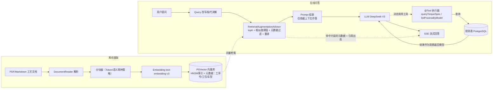

# 工业工艺知识库智能问答系统（Industrial SOP RAG Assistant）
---

## 一句话简介

基于 **Spring AI 1.0 + PGVector** 的工业工艺文档智能问答系统：将工艺规程/SOP/防错规则文档构建为可溯源的知识库，回答"某工位扭矩标准是多少"这类问题并给出**出处引用**；数值类精确查询通过 Function Calling 走结构化数据，避免大模型幻觉。


## 项目背景
- 汽车制造工厂的工艺防错系统（EP）每天产生大量工艺规程、BOM 比对规则和作业指导书，现场工程师和操作人员检索这些信息依赖人工翻阅，响应慢。
- 制造行业普遍存在"老师傅经验流失、工艺文档知识孤岛"问题：文档分散在 PDF/Word/扫描件中，传统关键词搜索无法回答"电车车型在 XX 工位与前驱产线有什么不同工艺要求"这类自然语言问题。
- 工艺问答对**准确性要求极高**：答错扭矩参数可能导致装配质量事故，因此系统必须做到**答案可溯源**、**精确数值不靠生成**。

本项目为上述场景的可运行原型验证。

> 说明：本项目使用**公开可获取的制造业文档样本**构建知识库，不包含任何真实企业数据。


## 核心特性

- **RAG 全链路**：文档解析 → 分块 → Embedding → 向量入库 → 语义检索 → Prompt 组装 → SSE 流式回答
- **双分块策略 A/B 对比**：固定 Token 窗口 vs 按工序/标题语义分块，附召回评测数据（见"效果评测"）
- **引用溯源**：每条回答返回命中文档名 + 章节/工序号，可点击查看原文片段
- **工业元数据过滤检索**：按车型（油车/电车）、产线、工位过滤后再做向量检索
- **RAG + Function Calling 混合架构**：扭矩/角度等精确数值走 `@Tool` 结构化查询，不依赖生成
- **多轮对话**：ChatMemory（Redis 持久化）+ 检索前 query 指代消解改写
- **一键部署**：Docker Compose 启动向量库与应用

## 系统架构


## 技术栈与选型取舍
| 组件 | 选型 | 理由 |
|---|---|---|
| 框架 | Spring AI 1.0.x | 与现有 Spring Boot 技术栈无缝；<2.0 刚发布生态教程少> |
| 对话模型 | DeepSeek-V3（OpenAI 兼容协议） | 成本低、国内直连；通过协议抽象可无缝切换通义/GPT |
| Embedding | 阿里 text-embedding-v3 | 中文效果与免费额度；放弃本地 bge（无 GPU） |
| 向量库 | PGVector（PG16 + HNSW） | 单人项目运维成本远低于 Milvus；VectorStore 抽象保留切换能力 |
| 会话记忆 | Redis ChatMemory | 集群共享会话；顺带解决重启丢失上下文 |
| 精确数值 | Function Calling 查库 | 工艺参数不允许模型"猜测"——本项目的核心设计原则 |
| 部署 | Docker Compose + 多阶段构建 | 一条命令复现 |

## 快速开始

```bash
# 1. 配置密钥（切勿提交）
cp .env.example .env    # 填入 DEEPSEEK_API_KEY、DASHSCOPE_API_KEY

# 2. 启动向量库 + 应用
docker compose up -d

# 3. 摄取样例文档
curl -X POST localhost:8080/api/ingest -F "file=@samples/sop-example.pdf"

# 4. 问答
curl -N "localhost:8080/api/chat?question=前驱总成工位的拧紧扭矩要求是多少"
```

在线演示：<部署地址，可选> ｜ Swagger：`/swagger-ui.html`
## 效果评测
评测集：<N> 条人工构造问答对（`eval/qa-dataset.json`，含期望命中文档与答案要点）。

| 实验组 | Top-K 召回命中率 | 答案要点覆盖率 | 备注 |
|---|---|---|---|
| 无 RAG 基线（纯 LLM） | - | <x>% | 编造参数、无出处 |
| Token 分块 512/overlap 15% | <x>% | <x>% | |
| 语义分块（按工序段） | <x>% | <x>% | 命中率提升 <y> 个百分点 |
| 语义分块 + 元数据过滤 | <x>% | <x>% | |
| 语义分块 + 重排 | <x>% | <x>% | |

典型 case 对比（截图放 `docs/images/`）：
- ✅ 正确：`<问题 + 回答 + 引用出处截图>`
- ❌ 失败：`<一个检索失败的 bad case + 原因分析>`
## 目录结构

```
src/main/java/...
├── controller/     # chat(流式) / ingest / eval
├── ai/             # Advisor 配置、query 改写、重排策略
├── ingest/         # DocumentReader + 两种分块器
├── tool/           # @Tool: queryTorqueSpec, listProcessByModel
└── repository/     # PG 规则表 / 向量库访问
eval/               # 问答评测集与跑分脚本
samples/            # 公开脱敏样例文档
docker-compose.yml  # pgvector + app
```

## 已知局限与后续计划
- 混合检索（BM25 关键词 + 向量）未实现 → 现状依赖向量召回，专有名词检索有短板
- 评测集规模小（<N> 条），覆盖率结论统计意义有限
- 未做增量更新与文档版本管理（同名文档重摄目前全量替换）
- 计划：引入 rerank API 精排；知识库多租户隔离；参考 Agentic RAG 做检索失败自动改写重试

## 安全与合规

- API Key 通过环境变量注入，`.gitignore` 排除；README 与代码不含任何密钥
- 知识库语料全部来自公开文档样本，不涉及企业真实数据

## License / 联系方式

MIT ｜ 卢耀辉 ｜ 1459194268@qq.com ｜ GitHub: <你的仓库链接>
